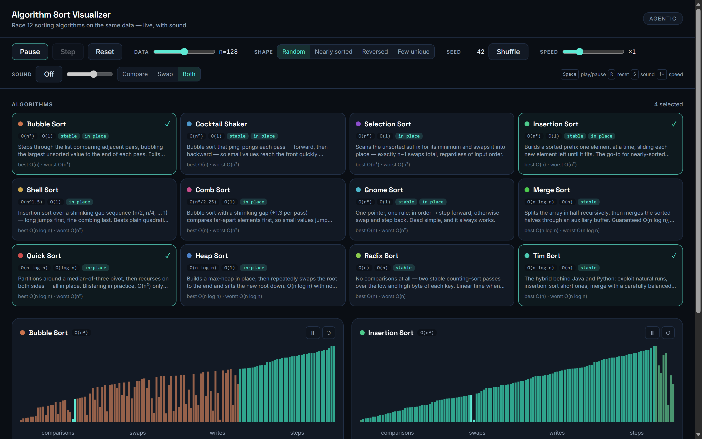

# Algorithm Sort Visualizer

Race **12 sorting algorithms on the same data** — live, in-browser, with sound.
A self-contained lab: pure-TS step-machine engines, canvas rendering, fully
synthesized audio, shareable URLs, keyboard and screen-reader support.
Zero network at runtime (fonts are bundled, audio is synthesized).



## The twelve

| | | |
|---|---|---|
| Bubble Sort | Cocktail Shaker | Selection Sort |
| Insertion Sort | Shell Sort | Comb Sort |
| Gnome Sort | Merge Sort | Quick Sort (Lomuto) |
| Heap Sort | Radix Sort (2-pass, 16-bit keys) | Tim Sort (run merge) |

Each algorithm is a deterministic step machine (`step() → Action | null`) —
no DOM, no timers — so every comparison, swap and write is unit-testable and
visually exact.

## Run it

```bash
npm install
npm run dev      # http://localhost:4180
npm test         # 48 node --test suites, zero dependencies
npm run build    # tsc --noEmit && vite build
```

**Controls**

- `Space` play/pause · `R` reset · `S` sound · `↑`/`↓` speed
- Per lane: pause, single-step, reset
- Any race is shareable: `?algos=bubble,quick&n=256&dist=reversed&speed=8&seed=42`
  (invalid fields drop individually; the URL canonicalizes on load)

## Architecture

```
src/lab/
├── engine/    pure-TS step machines + data generator + registry (12 algos)
├── render/    DPR-aware canvas lane renderer
├── audio/     SoundEngine — 100% synthesized (oscillators + gain envelopes);
│              AudioContext is created/resumed only inside a user gesture
├── ui/        React 19 + Tailwind v4 + framer-motion; pure URL state module
├── scheduler.ts  one rAF loop, per-frame action budget × speed
└── index.tsx  root: URL state, keyboard, aria-live status, __SORTLAB__ seam
```

- **RaceScheduler** drives every lane from a single `requestAnimationFrame`
  loop; each frame consumes an action budget (base 24 × speed). React only
  polls stats at 4 Hz — rendering never waits on React.
- **SoundEngine** maps compares/swaps/writes to pitch and gain; zero
  audio files, zero warnings (no autoplay violations).
- **`window.__SORTLAB__`** debug seam: `getState()`, `forceStepAll()`,
  `snapshot()` (proves each lane satisfies its sort contract — strict order
  for comparison sorts, stable 16-bit-key order for radix).

## Verification

[REVIEW.md](REVIEW.md) — gate scorecard (G1–G9), five findings (2×P1, 3×P2)
all found and fixed, browser-verified evidence at 1440 / 768 / 375, and
production-build checks.

## Lift into the portfolio

The lab folder is self-contained (enforced by a grep gate — every import in
`src/lab/` stays inside it or is a package: `react`, `framer-motion`). To
lift it:

1. Copy `src/lab/` → `portfolio/src/labs/sort-visualizer/` (see
   `portfolio/LABS.md` for the lab contract).
2. Zero code changes: `meta.ts` ships a local `types.ts` structurally
   identical to the portfolio's `LabMeta`. Optionally swap the import to the
   shared alias (`@/labs/types`) and delete `types.ts`.
3. Set `github` in `meta.ts` to this repo's URL once it is public.

The portfolio shell provides the frame; `SortLab` takes no props and fills
its container. `status` is already `'live'`.
